<p align="center">
  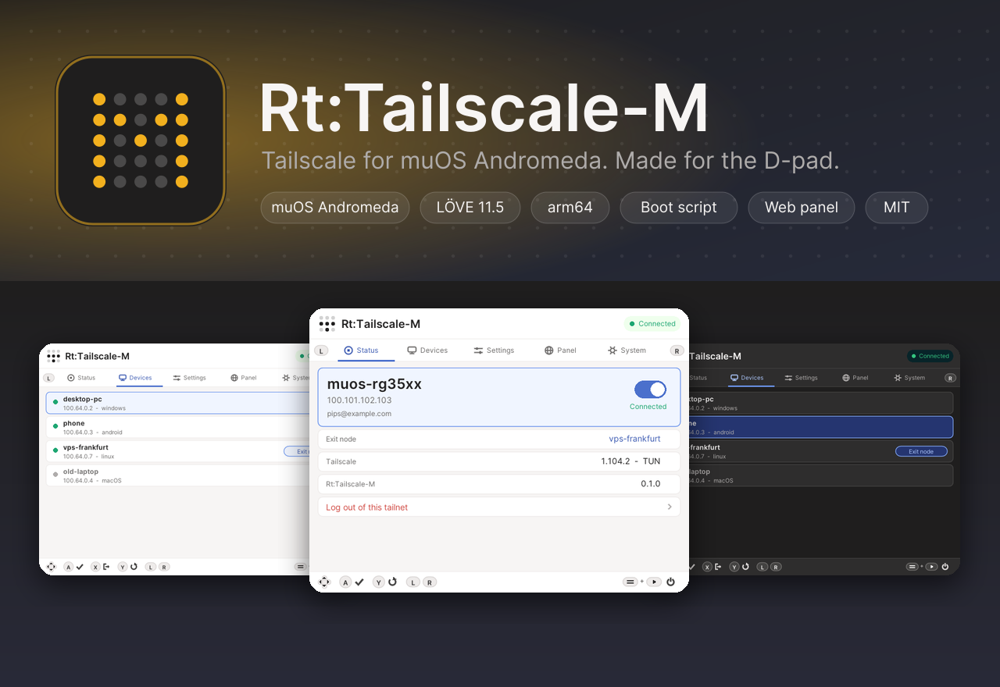
</p>

<p align="center">
  <a href="https://muos.dev"></a>
  <a href="https://love2d.org"></a>
  <a href="https://tailscale.com"></a>
  
  <a href="LICENSE"></a>
</p>

<h3 align="center">Run <a href="https://tailscale.com">Tailscale</a> on your muOS handheld - and control it with the D-pad.</h3>

Rt:Tailscale-M installs the official Tailscale client as a **background service** and gives you a graphical app,
styled after the Tailscale web client, to log in (by scanning a QR code), see your tailnet, pick an **exit node**,
flip settings and open a **web panel** for your phone. It is the muOS Andromeda sibling of Rt:Tailscale-K (Knulli)
and the successor of *Shin RtTailscale*, by SPDW Factory.

<p align="center"><a href="#-install">Install</a> · <a href="#-what-it-looks-like">Screenshots</a> · <a href="#-controls">Controls</a> · <a href="#-how-it-works">How it works</a> · <a href="#-status---what-is-tested">Status</a> · <a href="docs/DEVELOPING-FOR-MUOS.md">Developer guide</a></p>

---

## ✨ Features

| | |
|---|---|
| 🔌 **Official Tailscale** | The real arm64 `tailscale`/`tailscaled`, not a re-implementation. One tap updates them. |
| 🚀 **Starts at boot** | A muOS *user init script*, installed and switched on for you. A watchdog restarts anything that dies. |
| 📱 **Log in by QR code** | No typing on a D-pad: scan the code with your phone. |
| 🌍 **Exit nodes** | Highlight a device, press the button, your traffic leaves through it. |
| 🎮 **Made for the D-pad** | Icon-only button legend, light and dark theme, quit with SELECT+START. |
| 🌐 **Web panel** | PIN-protected panel (status, peers, Taildrop, Serve/Funnel, CLI console) on port 8077. |
| 📥 **Taildrop** | Files sent to the device land in `RtTailscale/taildrop/`. |
| 🧰 **Works without TUN** | No `/dev/net/tun` in your kernel? It falls back to userspace networking by itself. |
| 📦 **Self-contained** | Ships its own LÖVE 11.5 runtime (muOS has none), like other muOS LÖVE apps. Nothing to install first. |
| 🔁 **Switch painlessly** | Installs over *Shin RtTailscale* keeping your login; *Take over another Tailscale install* imports the identity of another app and disables its init script. |

## 🖼 What it looks like

Everything below is rendered by the real UI code (`tests/fixtures` provide the data), light and dark.

<table>
<tr>
<td align="center">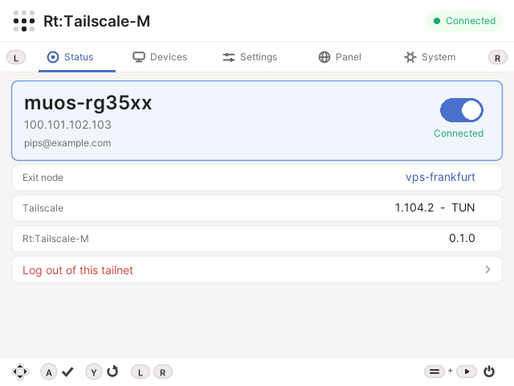<br><sub><b>Status</b> - connect / disconnect with one button</sub></td>
<td align="center">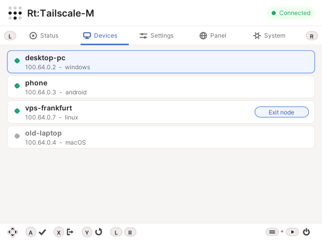<br><sub><b>Devices</b> - ping, use as exit node</sub></td>
<td align="center">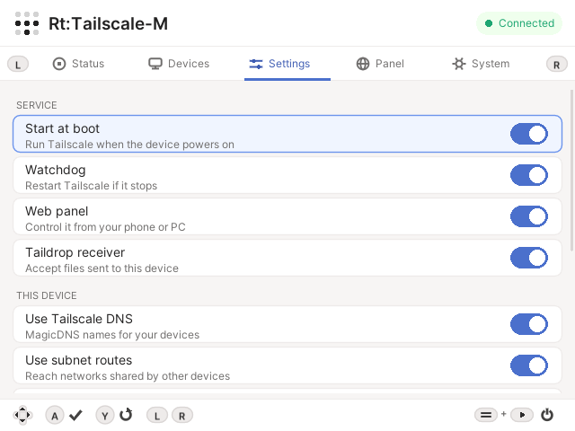<br><sub><b>Settings</b> - service and Tailscale options</sub></td>
</tr>
<tr>
<td align="center">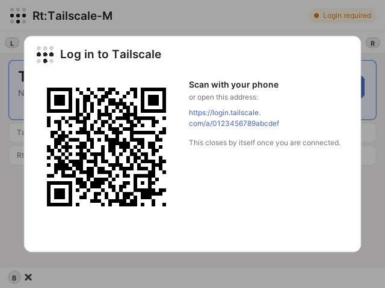<br><sub><b>Log in</b> - scan with your phone</sub></td>
<td align="center">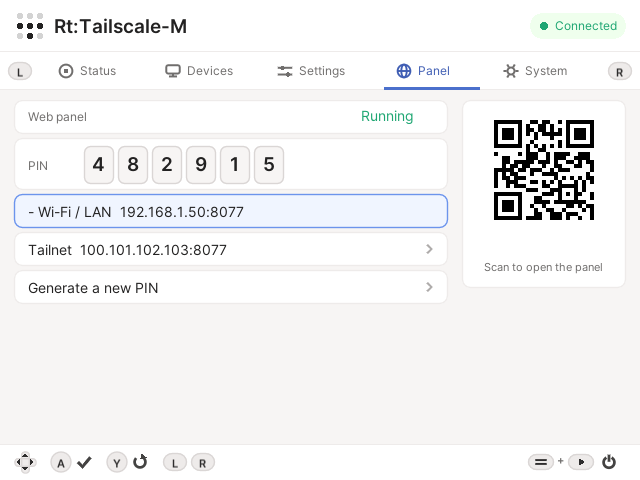<br><sub><b>Panel</b> - PIN and QR for the web panel</sub></td>
<td align="center">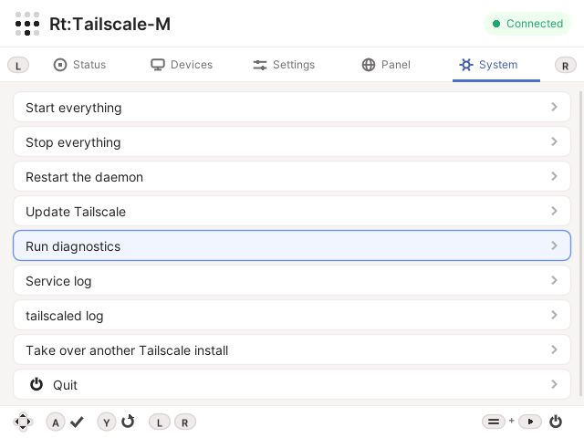<br><sub><b>System</b> - start, stop, update, diagnostics</sub></td>
</tr>
<tr>
<td align="center">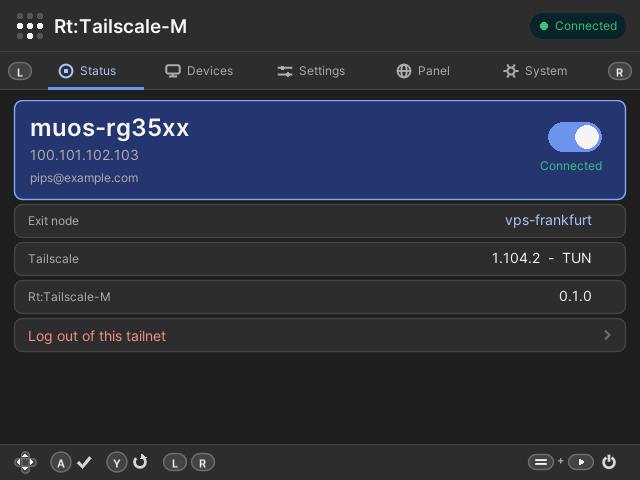<br><sub><b>Dark</b> status</sub></td>
<td align="center">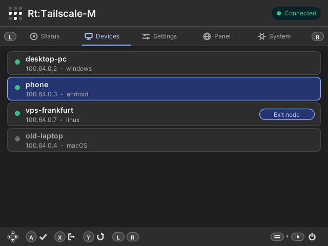<br><sub><b>Dark</b> devices</sub></td>
<td align="center">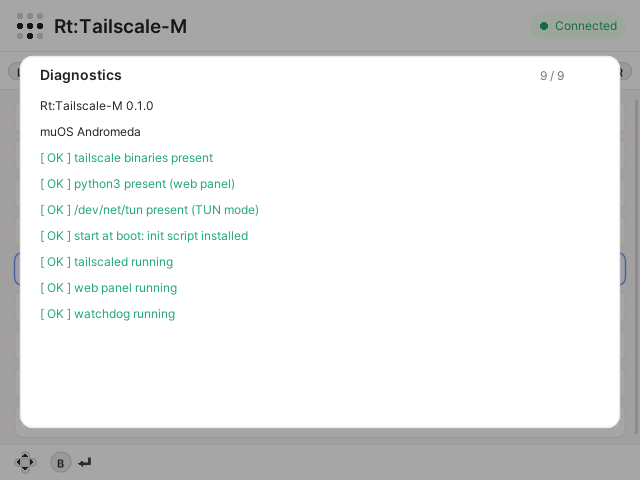<br><sub><b>Diagnostics</b></sub></td>
</tr>
</table>

## 🎮 Controls

<p align="center">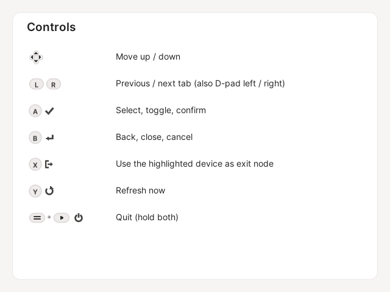</p>

The app never prints a key legend: it shows the buttons themselves (the same icons you see at the bottom of every screen).
Names follow the **Nintendo layout** of Anbernic handhelds (A = right button, B = bottom); if your buttons feel swapped,
turn it off in *Settings → Nintendo button layout*. Keyboard (for testing on a PC): arrows, Enter = A, Esc = B,
X, Y, Q/E = L/R, Ctrl+Q = quit.

## 📦 Install

1. Download `RtTailscale-M-<version>.muxapp` from Releases (or [build it](#-build-from-source)).
2. Copy it to the **`ARCHIVE`** folder of an SD card (e.g. `/mnt/mmc/ARCHIVE/`) and open
   **muOS → Applications → Archive Manager**, or unzip it into `MUOS/application/` so you get `MUOS/application/RtTailscale/`.
3. Open **Applications → Tailscale**.
4. **Status → Log in**, scan the QR code, approve the device in your Tailscale account.
5. **Settings → Start at boot** → on. The app creates the init script and switches on muOS's
   *Advanced settings → User Init Scripts* if it was off.

> [!NOTE]
> Already using *Shin RtTailscale*? Install over it: same folder, your login and settings stay.
> Using another Tailscale app? Open **System → Take over another Tailscale install**.

<details>
<summary><b>Use it without the app (SSH only)</b></summary>

```sh
cd /mnt/mmc/MUOS/application/RtTailscale        # or wherever the app lives
./rt install            # permissions, folders
./rt start              # daemon + watchdog + panel
./ts up                 # log in (prints a link)
./rt autostart on       # start at boot
./rt doctor             # health check
./rt                    # all commands
```
`./ts` is the real `tailscale` CLI bound to this daemon.
</details>

## 🌐 Web panel

`http://<device-ip>:8077` on your LAN, or `http://<tailscale-ip>:8077` from anywhere on your tailnet (preferred: nothing to
open on your router). The PIN is on the app's **Panel** tab (with a QR code of the address) or `./rt pin`.
HMAC-signed session, `HttpOnly`/`SameSite=Strict` cookie, lock-out after 5 wrong PINs.

## 🧩 How it works

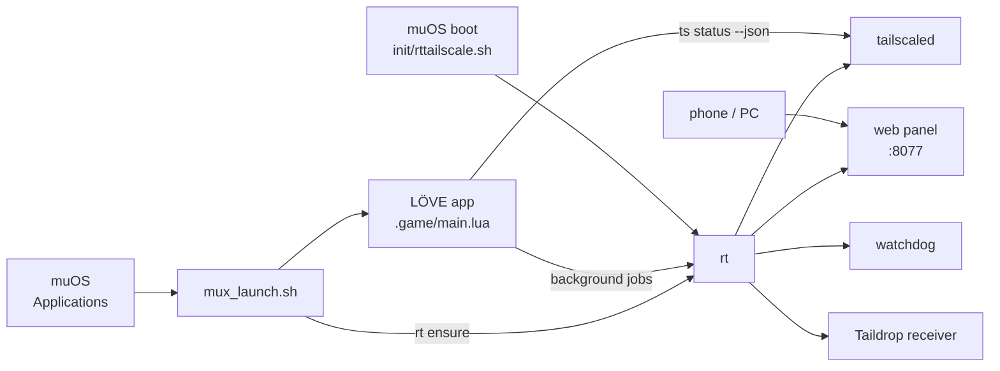

```
RtTailscale/                 (MUOS/application/RtTailscale)
├── mux_launch.sh  mux_lang.ini  glyph/      what muOS needs to list and start the app
├── rt  watchdog  ts         service manager, watchdog, CLI wrapper
├── bin/                     tailscale + tailscaled (arm64)
├── state/                   node identity (keep it private)
├── config/rt.conf           settings (also editable in the web panel)
├── taildrop/                received files
├── panel/                   web panel (python3, standard library only)
└── .game/                   LÖVE app: main.lua, Inter font, icons drawn in code, bin/love + libs.aarch64
```

Outside that folder the app only creates `init/rttailscale.sh` (when you enable start at boot) and temporary files in `/tmp`.
Uninstall: *Settings → Start at boot → off*, *System → Stop everything*, delete the folder.

## 🛠 Build from source

```sh
./build.sh                       # downloads Tailscale (arm64) and the pinned LÖVE runtime, builds dist/*.muxapp
./build.sh --bin-dir DIR         # use Tailscale binaries you already have
./build.sh --full-love           # ship the whole 73 MB runtime instead of the 9 libraries love needs (6 MB)
./build.sh --no-bin              # tiny archive; the app downloads Tailscale on first start
python3 tools/make_assets.py     # regenerate logo, banner, hero and the app icon
```

## 📦 Archive size

The trimmed `.muxapp` is ~39 MB, almost entirely the two statically
linked Go binaries `bin/tailscale` and `bin/tailscaled` (~50–60 MB
uncompressed). The bundled LÖVE runtime and its 9 needed libraries
are only ~8 MB of that; the `--full-love` variant adds ~67 MB of
unused Qt6/ICU/Kerberos libraries on top.

## ✅ Status - what is tested

| Area | How |
|---|---|
| Service stack with the **real arm64 Tailscale 1.104.2** (under qemu-user) | 21 integration checks: start, NeedsLogin, userspace mode, watchdog restart, deliberate stop, panel login, **boot via the init script**, taking over another app |
| Parsing of real `tailscale status --json` / `debug prefs` | against output of the real daemon |
| QR encoder | byte-identical to python-qrcode (v1-10) and decoded by OpenCV |
| **Real muOS Andromeda device** | launch, controller, init folder, User Init Scripts, QR login, binary update — all verified on hardware |
| UI | rendered headless with LÖVE (12 screens); the login flow starts a real `tailscale up` process |
| Packaging | pinned LÖVE runtime (commit + SHA-256), executable bits, layout checked |

```sh
tests/run_all.sh                                  # lint, Lua tests, QR verification, UI render
RT_BIN_DIR=/path/to/arm64/bins tests/run_all.sh   # + integration tests with the real binaries
```

> [!NOTE]
> **Verified on a real muOS Andromeda device** — launch via `SETUP_APP`,
> the bundled LÖVE runtime, the controller mapping, the init folder
> `/run/muos/storage/init`, the *User Init Scripts* setting, the QR login
> against Tailscale's servers and the binary-update download have all been
> exercised on hardware. If a build does not start on your device, see
> `docs/TROUBLESHOOTING.md`; `--full-love` is a fallback, not the default.

## 📚 Documentation

[Developing programs for muOS](docs/DEVELOPING-FOR-MUOS.md) · [Architecture](docs/ARCHITECTURE.md) ·
[Troubleshooting](docs/TROUBLESHOOTING.md) · [Changelog](CHANGELOG.md) · [Contributing](CONTRIBUTING.md) · [Third-party notices](THIRD-PARTY.md)

## 🙏 Credits and legal

- **Tailscale** and the Tailscale logo are trademarks of Tailscale Inc. The nine-dot mark appears **unmodified** (app icon and header) to show
  that this app works with Tailscale; this project is **not affiliated with or endorsed by** Tailscale Inc. or MustardOS. Colours and the
  Inter typeface follow the [Tailscale web client](https://github.com/tailscale/tailscale/tree/main/client/web) (BSD-3-Clause).
- **Inter** © The Inter Project Authors, SIL Open Font License 1.1.
- Built with [LÖVE](https://love2d.org); the aarch64 runtime is the one used by existing muOS LÖVE apps. Launcher conventions follow the
  [MustardOS](https://muos.dev) application format.
- The project logo (an "M" made of dots) is original artwork. Code: **MIT**, © SPDW Factory.

## Security notes

- The web panel binds to `PANEL_BIND` (default `0.0.0.0`, i.e. all
  interfaces). For LAN-only access set `PANEL_BIND=127.0.0.1` in
  `config/rt.conf` and reach it via SSH tunnel or `tailscale serve`.
- The panel uses plain HTTP on the LAN. **Do not expose the port to the
  Internet.** Use `tailscale serve` for remote access — it terminates TLS
  and authenticates via Tailscale identities.
- PIN is 8 digits for new installs. Rotate it with `./rt pin new`
  (also invalidates all sessions).
- The CLI console blocks `ssh`, `web`, `serve` and `funnel` because those
  are interactive or have dedicated validated endpoints.
